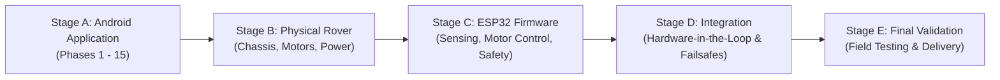

# FarmVision AgriRover

[](docs/roadmap.md)
[-123B2A?style=for-the-badge&logo=android)](app/)
[](gradle/libs.versions.toml)
[](https://github.com/Ashish2876/FarmVision-The-AgriRover)

> **FarmVision AgriRover** is an intelligent smart-agriculture robotics platform combining advanced field vision, autonomous rover telemetry, sensor acquisition, and precision crop analytics.

---

## 1. Project Overview & Long-Term Vision

FarmVision AgriRover bridges cutting-edge embedded robotics and modern mobile computing to empower farmers, agronomists, and agricultural researchers with real-time field intelligence. 

The complete long-term system architecture encompasses:
1. **Android Application**: Comprehensive operator command center featuring mission control dashboards, manual and autonomous rover piloting, live sensor monitoring, plant health diagnostics, AI agricultural assistant, and field analytics.
2. **Physical Agricultural Rover (Stage B)**: Robust, all-terrain agricultural rover chassis equipped with high-torque DC geared motors, motor drivers (H-Bridge/PWM), dedicated rechargeable power management, and agricultural sensor payloads.
3. **ESP32 Firmware (Stage C)**: High-reliability real-time embedded firmware running on the ESP32 microcontroller, executing sensor data acquisition, precision motor actuation, safety watchdogs, and failsafe motor cutoffs.
4. **Communication & Telemetry (Stage D)**: Resilient communication layer linking Android and the rover hardware with real-time command acknowledgements, heartbeats, and automated emergency stops upon connection loss.
5. **Backend & Cloud Telemetry**: Scalable telemetry ingestion, spatial farm mapping, historical crop data persistence, and synchronization.
6. **Edge & On-Device AI/ML**: Deep-learning models for localized plant-leaf disease classification, weed identification, and yield forecasting.
7. **System Validation & Field Testing (Stage E)**: Rigorous end-to-end hardware-in-the-loop (HIL) validation, field trials across varying terrain, outdoor sunlight UX verification, and fault recovery.

---

## 2. Staged Development Order & Strategy

To guarantee architectural stability and maintainable delivery, FarmVision AgriRover follows a structured five-stage lifecycle:



### Current Scope: Phase 1 of 15 (Android Foundation & Architecture)
In accordance with the project master plan, current implementation is strictly focused on **Phase 1**:
- Inspecting workspace and Android toolchains.
- Establishing modern Android technical foundation with Gradle Kotlin DSL, Version Catalog (`gradle/libs.versions.toml`), and Java 17.
- Implementing the centralized, nature-inspired futuristic design system and token engine.
- Building the branded, minimal application entry screen.
- Documenting system architecture, design tokens, and the complete 15-phase roadmap.
- Executing baseline build and automated test verification.
- Safe preparation for publication to the official GitHub repository (`Ashish2876/FarmVision-The-AgriRover`).

> **Boundary Notice**: Features such as full navigation shells, rover controllers, real-time telemetry charts, live hardware sockets, and physical firmware belong to subsequent phases and stages. Phase 1 provides the clean, buildable baseline without fabricating fake hardware telemetry.

---

## 3. Technology Stack & Dependencies

| Layer | Technology | Version / Specification |
| :--- | :--- | :--- |
| **Language** | Kotlin | `2.0.21` |
| **UI Framework** | Jetpack Compose & Material 3 | Compose BOM `2024.10.01` |
| **Build Tooling** | Gradle & Android Gradle Plugin (AGP) | Gradle `8.11` • AGP `8.7.2` |
| **Dependency Management** | Gradle Version Catalog | `gradle/libs.versions.toml` |
| **JDK Toolchain** | OpenJDK / Microsoft JDK | Java 17 (`17.0.18+8`) |
| **Android SDKs** | Compile SDK / Target SDK / Min SDK | Compile `35` • Target `35` • Min `26` (Android 8.0+) |
| **Architecture** | Unidirectional Data Flow (UDF) & Clean Architecture | Layered Presentation, Domain, and Data |
| **Testing** | JUnit 4, AndroidX Test, Compose UI Test | JUnit `4.13.2` • Espresso `3.6.1` |

---

## 4. Visual Identity & Design Principles

FarmVision AgriRover introduces a distinctive design language tailored for agricultural technology:
- **Futuristic Yet Pragmatic**: Industrial aesthetics with clear telemetry visualizers without distracting fluorescent neon clutter.
- **Nature-Inspired Palette**:
  - `Deep Forest (#123B2A)`: Grounded primary containers and structural anchors.
  - `Primary Green (#218C5B)`: High-priority operational triggers and brand highlights.
  - `Fresh Leaf (#62C985)`: Key typography, active telemetry indicators, and icons.
  - `Mint Accent (#A8E6C1)`: Tactical highlights, chip borders, and glowing badges.
  - `Dark Background (#0B1410)`: High-efficiency, low-power dark canvas optimized for outdoor sunlight contrast.
  - `Dark Surface (#14221B)` & `Variant (#1C2E25)`: Layered modular cards.
- **High-Contrast Readability**: Optimized for outdoor readability in varying direct sunlight conditions with accessible font sizes and touch targets $\ge 48\text{dp}$.

Detailed token definitions, typographic scales, and shape metrics are documented in [docs/design-system.md](docs/design-system.md).

---

## 5. Repository Structure

```text
FarmVision/
├── .gitignore                      # Android Studio, Gradle, and OS ignore rules
├── build.gradle.kts                # Top-level root build configuration
├── settings.gradle.kts             # Plugin repositories and module includes
├── gradle.properties               # JVM memory, caching, and AndroidX options
├── gradlew / gradlew.bat           # Gradle wrapper scripts (v8.11)
├── gradle/
│   ├── libs.versions.toml          # Centralized version catalog
│   └── wrapper/
│       ├── gradle-wrapper.jar
│       └── gradle-wrapper.properties
├── app/
│   ├── build.gradle.kts            # App module configuration & dependencies
│   ├── proguard-rules.pro          # ProGuard optimization rules
│   └── src/
│       ├── main/
│       │   ├── AndroidManifest.xml # App manifest & launcher activity declaration
│       │   ├── java/com/farmvision/agrirover/
│       │   │   ├── MainActivity.kt # Edge-to-edge entry point activity
│       │   │   └── ui/
│       │   │       ├── entry/      # Minimal branded Phase 1 entry screen
│       │   │       └── theme/      # Centralized theme tokens (Color, Type, Shape, Theme)
│       │   └── res/
│       │       ├── drawable/       # Vector drawables (adaptive icons, logo, badges)
│       │       ├── mipmap-anydpi-v26/ # Adaptive launcher icons
│       │       └── values/         # strings.xml, colors.xml, themes.xml
│       ├── test/                   # JVM unit tests (BaselineUnitTest.kt)
│       └── androidTest/            # Instrumented Compose tests (EntryScreenTest.kt)
└── docs/
    ├── architecture.md             # Complete system architecture & hardware boundaries
    ├── design-system.md            # Tokens, typography, shapes, and accessibility
    └── roadmap.md                  # Comprehensive 15-phase roadmap + hardware stages
```

---

## 6. Getting Started & Build Instructions

### Prerequisites
1. **Java Development Kit (JDK)**: JDK 17 installed with `JAVA_HOME` configured.
2. **Android SDK**: Android SDK with API Level 35 platform and Build-Tools 35.0.0 installed.
3. **Android Studio**: Android Studio Ladybug (2024.2.1+) or newer recommended.

### Building via Command Line
Execute the standard Gradle commands from the repository root:

```bash
# Check Gradle and environment configuration
./gradlew -v

# Run local JVM unit tests
./gradlew testDebugUnitTest

# Assemble Debug APK
./gradlew assembleDebug
```
The compiled debug APK will be generated at:
`app/build/outputs/apk/debug/app-debug.apk`

---

## 7. Documentation Index

- [docs/architecture.md](docs/architecture.md): Presentation, Domain, Data boundaries, telemetry interfaces, hardware safety, and package structures.
- [docs/design-system.md](docs/design-system.md): Color tokens, typography hierarchy, shape geometry, and Phase 2 component roadmap.
- [docs/roadmap.md](docs/roadmap.md): Complete 15-phase Android app milestones and Stages B through E hardware/firmware execution schedule.

---

## 8. Development Status & Approvals

- **Current Stage**: Stage A (Android Application)
- **Current Phase**: **Phase 1 of 15 (Completed & Ready for Baseline Verification)**
- **GitHub Target**: [Ashish2876/FarmVision-The-AgriRover](https://github.com/Ashish2876/FarmVision-The-AgriRover)
- **Phase 2 Authorization**: Pending explicit `APPROVED` command.
- **GitHub Push Authorization**: Pending explicit `AUTHORIZE PUSH` command.
