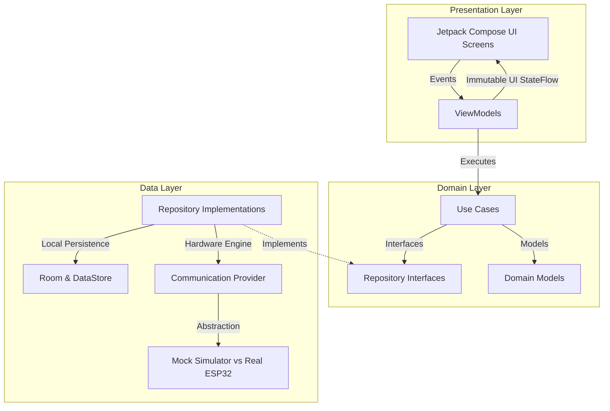
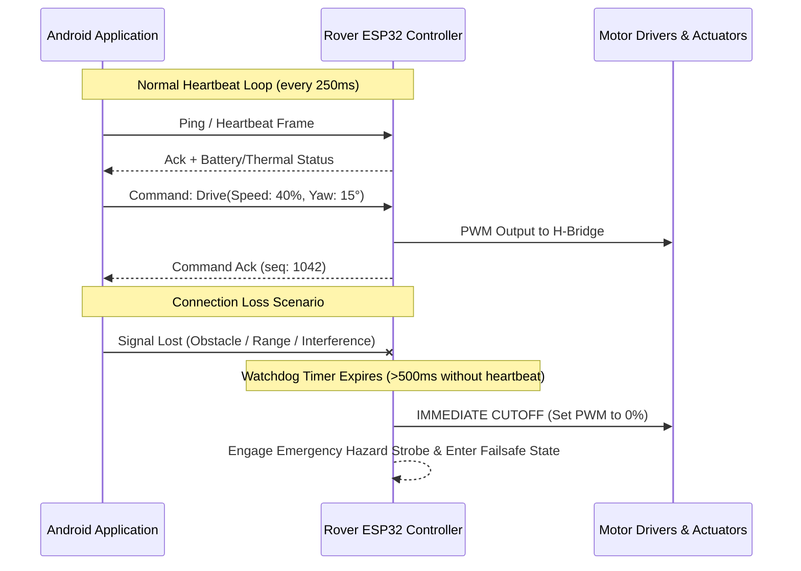

# FarmVision AgriRover — Architectural Blueprint & System Design

**Document Version:** 1.0.0 (Phase 1 Baseline)  
**Status:** Approved for Foundation Stage  
**Target Platform:** Android (Kotlin, Jetpack Compose, Material 3)  
**Hardware Target:** ESP32-based Agricultural Rover Robotics  

---

## 1. Architectural Philosophy & Core Principles

FarmVision AgriRover adheres to **Clean Architecture** combined with **Unidirectional Data Flow (UDF)**. The architecture separates visual presentation, pure domain business logic, and low-level data/hardware communication into distinct, loosely coupled layers.



### Core Tenets
1. **Separation of Concerns**: UI components remain purely declarative; they observe reactive state and emit user events. They know nothing about raw bytes, serial protocols, or network sockets.
2. **Hardware-Decoupled Development**: The Android application is developed with a strict contract-driven abstraction (`RoverTelemetryProvider` & `RoverCommandProvider`). The entire user experience can be developed and verified using high-fidelity mock engines before the physical rover is powered on.
3. **Safety-First Robotics Mindset**: Simulated commands must **never** be presented to the user as confirmed physical movements. Physical actuation requires verified cryptographic/stateful acknowledgements from the rover's firmware.
4. **Independent Hardware Watchdogs**: The rover hardware must never rely solely on the mobile device for basic safety. If communication is lost, the ESP32 must halt motors autonomously.

---

## 2. Layered Architecture Specifications

### 2.1 Presentation Layer
- **Framework**: Jetpack Compose using Material 3 design tokens.
- **State Management**: Each feature screen is paired with an `AndroidViewModel` exposing an immutable `StateFlow<UiState>`.
- **Event Handling**: UI actions are emitted as sealed interfaces (e.g., `RoverControlEvent.SendSpeedVector`, `PlantEvent.SelectPlant`) to ensure unidirectional execution.
- **Lifecycle Awareness**: ViewModels utilize `viewModelScope` and Compose collect routines with `repeatOnLifecycle` or `collectAsStateWithLifecycle` to prevent memory leaks and unnecessary background processing.

### 2.2 Domain Layer (Pure Kotlin)
- Contains business rules, domain entities, and single-responsibility Use Cases (`operator fun invoke(...)`).
- Zero dependencies on Android framework libraries or hardware SDKs, ensuring 100% JVM testability.
- Key Use Cases (planned for Phases 4–12):
  - `ObserveRoverTelemetryUseCase`: Merges battery health, GPS coordinates, motor RPM, and agricultural sensor readings into a unified stream.
  - `DispatchRoverCommandUseCase`: Validates command bounds (max velocity, steering limits, arm elevation) before dispatching to the repository.
  - `AnalyzePlantHealthUseCase`: Processes image inputs through local vision models to generate health indices.
  - `ProcessAlertRuleUseCase`: Evaluates sensor readings against dynamic agronomical thresholds (e.g., critical soil dryness).

### 2.3 Data Layer
- Implements repository interfaces defined by the domain layer.
- Mediates between:
  - **Local Persistence**: Room database for historical sensor logs, plant profiles, and mission paths. DataStore Preferences for user settings and pairing configuration.
  - **Remote / Hardware Sources**: Active telemetry streams, WebSocket/Bluetooth connections, and backend cloud synchronization.
- **Repository Interface Decoupling**: Repositories act as the single source of truth, caching incoming hardware telemetry into memory or local storage.

---

## 3. Hardware & Telemetry Abstraction

To ensure that the Android application can be developed and validated in Stage A before the physical rover (Stage B) and ESP32 firmware (Stage C) are complete, all hardware interactions are abstracted behind standard Kotlin interfaces:

```kotlin
interface RoverTelemetryProvider {
    val telemetryStream: Flow<RoverTelemetry>
    val connectionState: StateFlow<ConnectionStatus>
}

interface RoverCommandProvider {
    suspend fun executeCommand(command: RoverCommand): CommandResult
    suspend fun triggerEmergencyStop(): Boolean
}
```

### 3.1 Demo Mode vs. Real Hardware Mode
The application architecture supports dual-mode operation toggled via runtime configuration:
1. **Demo / Simulation Mode (Stage A Default)**:
   - Powered by `MockRoverEngine`.
   - Generates realistic, physics-bound telemetry (battery discharge curves, simulated GPS drift across farm coordinates, dynamic soil moisture and temperature oscillations).
   - Simulates realistic latency, simulated packet drop, and optional simulated connection loss to test UI error states and recovery screens.
2. **Real Hardware Mode (Stage D Integration)**:
   - Powered by `Esp32HardwareClient`.
   - Reads real-time binary/JSON telemetry from the physical rover's ESP32.
   - Dispatches actual motor commands and receives real physical acknowledgements.

---

## 4. Hardware Safety & Emergency Failsafes

When controlling physical agricultural machinery, software safety is critical. The architecture mandates the following safety boundaries:



### Safety Requirements
1. **Hardware-Side Watchdog**: The ESP32 firmware must maintain a standalone hardware watchdog timer. If no valid heartbeat packet is received within **500 milliseconds**, the motor driver enable pins are pulled LOW immediately, regardless of what the last received command was.
2. **No Physical Assumption from Simulation**: If the Android app is running in Demo Mode, the UI must prominently display an amber/cyan **SIMULATION ACTIVE** banner. Simulated movement must never be represented as physical confirmation.
3. **Dedicated Emergency Stop (E-Stop)**: The mobile UI must provide a high-priority, persistent E-Stop control in all active driving screens that bypasses regular command queues and transmits high-priority kill packets.
4. **Command Acknowledgement & Idempotency**: Every command contains a monotonically increasing sequence ID. The rover acknowledges receipt and state transition. Commands that do not receive an acknowledgement within 600ms are marked as `TIMEOUT` and flagged to the operator.

---

## 5. Future Communication Layer Protocol Evaluation

*Status: Decision Pending (Phased Analysis in Phase 11)*

The communication bridge between the Android application and the ESP32 rover will be finalized during Phase 11 based on field testing requirements:

| Protocol Candidate | Strengths | Limitations | Optimal Use Case |
| :--- | :--- | :--- | :--- |
| **Bluetooth Low Energy (BLE)** | Native Android support, low power consumption, simple zero-config pairing | Limited range (10–30m), limited bandwidth for live video streaming | Close-proximity pairing, initial setup, low-speed indoor maneuvering |
| **Wi-Fi SoftAP / Direct** | High bandwidth, low latency, supports live RTSP/MJPEG camera feeds | Higher power draw on ESP32, requires smartphone Wi-Fi handover | Full-field direct line-of-sight piloting with live video |
| **Wi-Fi + MQTT Broker** | Pub/Sub decoupled messaging, built-in QoS levels, cloud and local broker support | Requires network infrastructure (field router or IoT gateway) | Long-range agricultural automation, multi-rover fleet deployment |
| **WebSocket over TCP** | Full-duplex bidirectional streaming, minimal packet overhead | Requires persistent TCP connection handling and reconnect logic | Direct point-to-point telemetry and joystick control |

---

## 6. Proposed Future Package Structure

```text
com.farmvision.agrirover/
├── MainActivity.kt
├── FarmVisionApp.kt
├── core/
│   ├── designsystem/          # Material 3 Theme tokens, components, previews
│   │   ├── Color.kt
│   │   ├── Type.kt
│   │   ├── Shape.kt
│   │   ├── Theme.kt
│   │   └── components/        # Reusable buttons, cards, status chips (Phase 2)
│   ├── model/                 # Shared domain primitives (Telemetry, Plant, Alert)
│   └── common/                # Coroutine dispatchers, formatters, result wrappers
├── data/
│   ├── local/                 # Room database, DAOs, DataStore preferences
│   ├── remote/                # Communication engines, BLE, WebSockets, REST
│   ├── mock/                  # High-fidelity physics-based telemetry mock engine
│   └── repository/            # TelemetryRepositoryImpl, RoverCommandRepositoryImpl
├── domain/
│   ├── model/                 # Rich domain models & state definitions
│   ├── repository/            # Pure repository interfaces
│   └── usecase/               # Single-responsibility business use cases
├── feature/
│   ├── dashboard/             # Mission overview & quick telemetry widgets (Phase 5)
│   ├── controller/            # Virtual joystick, manual piloting, E-stop (Phase 6)
│   ├── plants/                # Crop & plant health catalog (Phase 7)
│   ├── monitoring/            # Comprehensive sensor visualizers (Phase 8)
│   ├── analytics/             # Historical yield & telemetry graphs (Phase 9)
│   ├── alerts/                # Urgent threshold notifications (Phase 10)
│   ├── assistant/             # AI Agronomist recommendations (Phase 12)
│   └── settings/              # Device pairing, calibration, theme options (Phase 13)
└── navigation/                # Compose Navigation graph, destinations, deep links
```

---

## 7. AI/ML Extension Points

Planned for Phase 12, the application's AI module will interface with:
1. **On-Device Plant Pathology Classifier**: Quantized TensorFlow Lite (TFLite) or MediaPipe model embedded in the application assets for instant leaf lesion, blight, and pest detection without needing an internet connection.
2. **Camera Stream Frame Analyzer**: Pipeline extracting frames from the rover's front-facing optical camera, computing Normalized Difference Vegetation Index (NDVI) approximations or weed segmentation masks.
3. **Agronomic LLM Advisor**: Extension point for generative crop diagnosis leveraging cloud APIs or on-device LLMs where supported.

---

## 8. Verification & Quality Assurance Strategy

The quality strategy spans four testing tiers:
1. **JVM Unit Tests (`app/src/test/`)**: Validate domain models, business logic calculations, use cases, and repository caching with mock coroutine dispatchers (`runTest`).
2. **Compose UI Tests (`app/src/androidTest/`)**: Verify user interactions, accessibility labels, semantics tree nodes, and theme transitions.
3. **Screenshot & Regression Testing**: Ensure visual fidelity across multiple screen densities (phone, 7" tablet, 10" outdoor rugged tablet).
4. **Hardware-in-the-Loop (HIL) Tests (Stage D)**: Automated integration scripts simulating packet drops, corrupted CRC checksums, and delayed ACKs to verify fail-safe recovery.

---

## 9. Phase 4 Domain Architecture & Boundaries

Phase 4 introduces a formal, pure-Kotlin domain layer and modular boundaries:

### 9.1 Boundary Contracts
- `TelemetrySource`: Exposes `telemetryFlow` and canonical `sensorReadingsFlow`. Implemented in Phase 4 by `MockFarmRepository` (`DataOrigin.Simulated`). Future Phase 11 hardware drivers (BLE, Wi-Fi Direct, MQTT) implement this interface without modifying UI screens.
- `CommandSink`: Handles piloting vectors, speed envelopes, and emergency stops. Enforces safety watchdogs (E-Stop latching, movement rejection while cutoff, mode changes never initiate movement).
- `HardwareCatalogSource`: Provides immutable access to the 23-item hardware inventory, controller profiles, and actuator configurations.

### 9.2 Canonical Units & Physical Validity
All sensor readings are stored in canonical units (°C, %, lx, pH, cm). Out-of-bounds readings are classified as `ReadingState.Invalid` and never displayed as valid numbers:
- **Soil Moisture**: 0.0% – 100.0% (canonical `%`)
- **Air Temperature**: -20.0°C – 70.0°C (canonical `°C`)
- **Relative Humidity**: 0.0% – 100.0% (canonical `%`)
- **Solar Light Intensity**: 0 – 150,000 lx (canonical `lx`; simulated, no physical sensor)
- **Soil pH**: 0.0 – 14.0 (canonical `pH`)
- **Obstacle Distance**: 2.0 – 400.0 cm (canonical `cm`)

### 9.3 Determinism & Injected Clock
Telemetry timestamps and staleness calculations are governed by an injectable `TimeProvider` interface (`SystemTimeProvider` for app runtime, `FakeTimeProvider` for deterministic unit testing).

### 9.4 Hardware Inventory Specification
The 23 physical components are documented in detail in [`docs/hardware-data-model.md`](hardware-data-model.md), with all pin numbers unassigned by default and configuration marked as draft.
