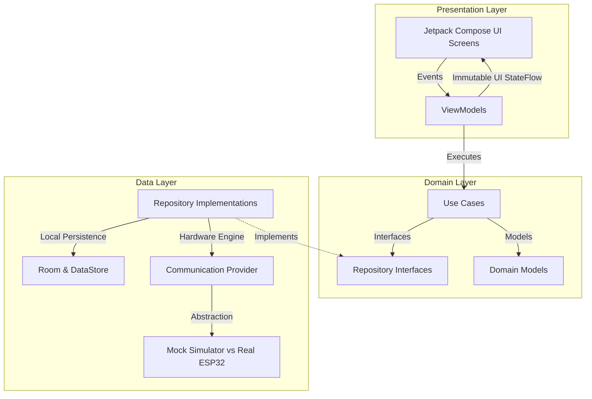
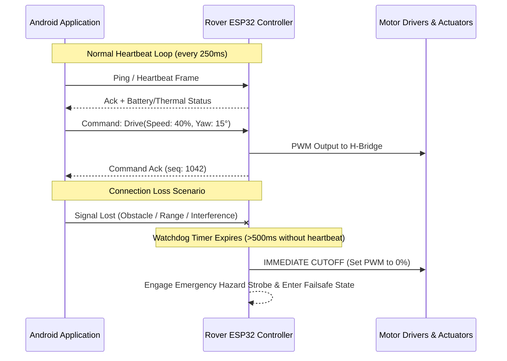

# FarmVision AgriRover — Architectural Blueprint & System Design

**Document Version:** 1.0.0 (Phase 1 Baseline)  
**Status:** Approved for Foundation Stage  
**Target Platform:** Android (Kotlin, Jetpack Compose, Material 3)  
**Hardware Target:** ESP32-based Agricultural Rover Robotics  

---

## 1. Architectural Philosophy & Core Principles

FarmVision AgriRover adheres to **Clean Architecture** combined with **Unidirectional Data Flow (UDF)**. The architecture separates visual presentation, pure domain business logic, and low-level data/hardware communication into distinct, loosely coupled layers.



### Core Tenets
1. **Separation of Concerns**: UI components remain purely declarative; they observe reactive state and emit user events. They know nothing about raw bytes, serial protocols, or network sockets.
2. **Hardware-Decoupled Development**: The Android application is developed with a strict contract-driven abstraction (`RoverTelemetryProvider` & `RoverCommandProvider`). The entire user experience can be developed and verified using high-fidelity mock engines before the physical rover is powered on.
3. **Safety-First Robotics Mindset**: Simulated commands must **never** be presented to the user as confirmed physical movements. Physical actuation requires verified cryptographic/stateful acknowledgements from the rover's firmware.
4. **Independent Hardware Watchdogs**: The rover hardware must never rely solely on the mobile device for basic safety. If communication is lost, the ESP32 must halt motors autonomously.

---

## 2. Layered Architecture Specifications

### 2.1 Presentation Layer
- **Framework**: Jetpack Compose using Material 3 design tokens.
- **State Management**: Each feature screen is paired with an `AndroidViewModel` exposing an immutable `StateFlow<UiState>`.
- **Event Handling**: UI actions are emitted as sealed interfaces (e.g., `RoverControlEvent.SendSpeedVector`, `PlantEvent.SelectPlant`) to ensure unidirectional execution.
- **Lifecycle Awareness**: ViewModels utilize `viewModelScope` and Compose collect routines with `repeatOnLifecycle` or `collectAsStateWithLifecycle` to prevent memory leaks and unnecessary background processing.

### 2.2 Domain Layer (Pure Kotlin)
- Contains business rules, domain entities, and single-responsibility Use Cases (`operator fun invoke(...)`).
- Zero dependencies on Android framework libraries or hardware SDKs, ensuring 100% JVM testability.
- Key Use Cases (planned for Phases 4–12):
  - `ObserveRoverTelemetryUseCase`: Merges battery health, GPS coordinates, motor RPM, and agricultural sensor readings into a unified stream.
  - `DispatchRoverCommandUseCase`: Validates command bounds (max velocity, steering limits, arm elevation) before dispatching to the repository.
  - `AnalyzePlantHealthUseCase`: Processes image inputs through local vision models to generate health indices.
  - `ProcessAlertRuleUseCase`: Evaluates sensor readings against dynamic agronomical thresholds (e.g., critical soil dryness).

### 2.3 Data Layer
- Implements repository interfaces defined by the domain layer.
- Mediates between:
  - **Local Persistence**: Room database for historical sensor logs, plant profiles, and mission paths. DataStore Preferences for user settings and pairing configuration.
  - **Remote / Hardware Sources**: Active telemetry streams, WebSocket/Bluetooth connections, and backend cloud synchronization.
- **Repository Interface Decoupling**: Repositories act as the single source of truth, caching incoming hardware telemetry into memory or local storage.

---

## 3. Hardware & Telemetry Abstraction

To ensure that the Android application can be developed and validated in Stage A before the physical rover (Stage B) and ESP32 firmware (Stage C) are complete, all hardware interactions are abstracted behind standard Kotlin interfaces:

```kotlin
interface RoverTelemetryProvider {
    val telemetryStream: Flow<RoverTelemetry>
    val connectionState: StateFlow<ConnectionStatus>
}

interface RoverCommandProvider {
    suspend fun executeCommand(command: RoverCommand): CommandResult
    suspend fun triggerEmergencyStop(): Boolean
}
```

### 3.1 Demo Mode vs. Real Hardware Mode
The application architecture supports dual-mode operation toggled via runtime configuration:
1. **Demo / Simulation Mode (Stage A Default)**:
   - Powered by `MockRoverEngine`.
   - Generates realistic, physics-bound telemetry (battery discharge curves, simulated GPS drift across farm coordinates, dynamic soil moisture and temperature oscillations).
   - Simulates realistic latency, simulated packet drop, and optional simulated connection loss to test UI error states and recovery screens.
2. **Real Hardware Mode (Stage D Integration)**:
   - Powered by `Esp32HardwareClient`.
   - Reads real-time binary/JSON telemetry from the physical rover's ESP32.
   - Dispatches actual motor commands and receives real physical acknowledgements.

---

## 4. Hardware Safety & Emergency Failsafes

When controlling physical agricultural machinery, software safety is critical. The architecture mandates the following safety boundaries:



### Safety Requirements
1. **Hardware-Side Watchdog**: The ESP32 firmware must maintain a standalone hardware watchdog timer. If no valid heartbeat packet is received within **500 milliseconds**, the motor driver enable pins are pulled LOW immediately, regardless of what the last received command was.
2. **No Physical Assumption from Simulation**: If the Android app is running in Demo Mode, the UI must prominently display an amber/cyan **SIMULATION ACTIVE** banner. Simulated movement must never be represented as physical confirmation.
3. **Dedicated Emergency Stop (E-Stop)**: The mobile UI must provide a high-priority, persistent E-Stop control in all active driving screens that bypasses regular command queues and transmits high-priority kill packets.
4. **Command Acknowledgement & Idempotency**: Every command contains a monotonically increasing sequence ID. The rover acknowledges receipt and state transition. Commands that do not receive an acknowledgement within 600ms are marked as `TIMEOUT` and flagged to the operator.

---

## 5. Future Communication Layer Protocol Evaluation

*Status: Decision Pending (Phased Analysis in Phase 11)*

The communication bridge between the Android application and the ESP32 rover will be finalized during Phase 11 based on field testing requirements:

| Protocol Candidate | Strengths | Limitations | Optimal Use Case |
| :--- | :--- | :--- | :--- |
| **Bluetooth Low Energy (BLE)** | Native Android support, low power consumption, simple zero-config pairing | Limited range (10–30m), limited bandwidth for live video streaming | Close-proximity pairing, initial setup, low-speed indoor maneuvering |
| **Wi-Fi SoftAP / Direct** | High bandwidth, low latency, supports live RTSP/MJPEG camera feeds | Higher power draw on ESP32, requires smartphone Wi-Fi handover | Full-field direct line-of-sight piloting with live video |
| **Wi-Fi + MQTT Broker** | Pub/Sub decoupled messaging, built-in QoS levels, cloud and local broker support | Requires network infrastructure (field router or IoT gateway) | Long-range agricultural automation, multi-rover fleet deployment |
| **WebSocket over TCP** | Full-duplex bidirectional streaming, minimal packet overhead | Requires persistent TCP connection handling and reconnect logic | Direct point-to-point telemetry and joystick control |

---

## 6. Proposed Future Package Structure

```text
com.farmvision.agrirover/
├── MainActivity.kt
├── FarmVisionApp.kt
├── core/
│   ├── designsystem/          # Material 3 Theme tokens, components, previews
│   │   ├── Color.kt
│   │   ├── Type.kt
│   │   ├── Shape.kt
│   │   ├── Theme.kt
│   │   └── components/        # Reusable buttons, cards, status chips (Phase 2)
│   ├── model/                 # Shared domain primitives (Telemetry, Plant, Alert)
│   └── common/                # Coroutine dispatchers, formatters, result wrappers
├── data/
│   ├── local/                 # Room database, DAOs, DataStore preferences
│   ├── remote/                # Communication engines, BLE, WebSockets, REST
│   ├── mock/                  # High-fidelity physics-based telemetry mock engine
│   └── repository/            # TelemetryRepositoryImpl, RoverCommandRepositoryImpl
├── domain/
│   ├── model/                 # Rich domain models & state definitions
│   ├── repository/            # Pure repository interfaces
│   └── usecase/               # Single-responsibility business use cases
├── feature/
│   ├── dashboard/             # Mission overview & quick telemetry widgets (Phase 5)
│   ├── controller/            # Virtual joystick, manual piloting, E-stop (Phase 6)
│   ├── plants/                # Crop & plant health catalog (Phase 7)
│   ├── monitoring/            # Comprehensive sensor visualizers (Phase 8)
│   ├── analytics/             # Historical yield & telemetry graphs (Phase 9)
│   ├── alerts/                # Urgent threshold notifications (Phase 10)
│   ├── assistant/             # AI Agronomist recommendations (Phase 12)
│   └── settings/              # Device pairing, calibration, theme options (Phase 13)
└── navigation/                # Compose Navigation graph, destinations, deep links
```

---

## 7. AI/ML Extension Points

Planned for Phase 12, the application's AI module will interface with:
1. **On-Device Plant Pathology Classifier**: Quantized TensorFlow Lite (TFLite) or MediaPipe model embedded in the application assets for instant leaf lesion, blight, and pest detection without needing an internet connection.
2. **Camera Stream Frame Analyzer**: Pipeline extracting frames from the rover's front-facing optical camera, computing Normalized Difference Vegetation Index (NDVI) approximations or weed segmentation masks.
3. **Agronomic LLM Advisor**: Extension point for generative crop diagnosis leveraging cloud APIs or on-device LLMs where supported.

---

## 8. Verification & Quality Assurance Strategy

The quality strategy spans four testing tiers:
1. **JVM Unit Tests (`app/src/test/`)**: Validate domain models, business logic calculations, use cases, and repository caching with mock coroutine dispatchers (`runTest`).
2. **Compose UI Tests (`app/src/androidTest/`)**: Verify user interactions, accessibility labels, semantics tree nodes, and theme transitions.
3. **Screenshot & Regression Testing**: Ensure visual fidelity across multiple screen densities (phone, 7" tablet, 10" outdoor rugged tablet).
4. **Hardware-in-the-Loop (HIL) Tests (Stage D)**: Automated integration scripts simulating packet drops, corrupted CRC checksums, and delayed ACKs to verify fail-safe recovery.

---

## 9. Phase 4 Domain Architecture & Boundaries

Phase 4 introduces a formal, pure-Kotlin domain layer and modular boundaries:

### 9.1 Boundary Contracts
- `TelemetrySource`: Exposes `telemetryFlow` and canonical `sensorReadingsFlow`. Implemented in Phase 4 by `MockFarmRepository` (`DataOrigin.Simulated`). Future Phase 11 hardware drivers (BLE, Wi-Fi Direct, MQTT) implement this interface without modifying UI screens.
- `CommandSink`: Handles piloting vectors, speed envelopes, and emergency stops. Enforces safety watchdogs (E-Stop latching, movement rejection while cutoff, mode changes never initiate movement).
- `HardwareCatalogSource`: Provides immutable access to the 23-item hardware inventory, controller profiles, and actuator configurations.

### 9.2 Canonical Units & Physical Validity
All sensor readings are stored in canonical units (°C, %, lx, pH, cm). Out-of-bounds readings are classified as `ReadingState.Invalid` and never displayed as valid numbers:
- **Soil Moisture**: 0.0% – 100.0% (canonical `%`)
- **Air Temperature**: -20.0°C – 70.0°C (canonical `°C`)
- **Relative Humidity**: 0.0% – 100.0% (canonical `%`)
- **Solar Light Intensity**: 0 – 150,000 lx (canonical `lx`; simulated, no physical sensor)
- **Soil pH**: 0.0 – 14.0 (canonical `pH`)
- **Obstacle Distance**: 2.0 – 400.0 cm (canonical `cm`)

### 9.3 Determinism & Injected Clock
Telemetry timestamps and staleness calculations are governed by an injectable `TimeProvider` interface (`SystemTimeProvider` for app runtime, `FakeTimeProvider` for deterministic unit testing).

### 9.4 Hardware Inventory Specification
The 23 physical components are documented in detail in [`docs/hardware-data-model.md`](hardware-data-model.md), with all pin numbers unassigned by default and configuration marked as draft.

---

## 10. Phase 6 Advanced Rover Controller Architecture

Phase 6 implements the tactile piloting and safety control interface for the FarmVision AgriRover:

### 10.1 Virtual 2-Axis Joystick & Touch Input
- **Perimeter Clamping**: The joystick displacement is constrained to a unit circle ($r \le 1.0$), ensuring that diagonal deflections do not exceed maximum permissible motor commands:
  $$r = \sqrt{x^2 + y^2}, \quad (x', y') = \begin{cases} (x, y) & \text{if } r \le 1.0 \\ \left(\frac{x}{r}, \frac{y}{r}\right) & \text{if } r > 1.0 \end{cases}$$
- **Continuous Radial Dead Zone**: A dead zone threshold of $r_{\text{dead}} = 0.08$ is enforced radially to eliminate accidental drift and analog thumb wobble. Deflections outside the dead zone are smoothly rescaled from 0 to 1 so no sudden step in velocity occurs:
  $$\vec{v}_{\text{dead}} = \begin{cases} (0, 0) & \text{if } r \le r_{\text{dead}} \\ \frac{r - r_{\text{dead}}}{1.0 - r_{\text{dead}}} \cdot \frac{\vec{v}}{r} & \text{if } r > r_{\text{dead}} \end{cases}$$
- **Single-Pointer Tracking**: Touch gestures track only the primary controlling finger, allowing simultaneous multi-touch interaction where a secondary finger can trigger Emergency Stop without pointer conflict.
- **Spring-to-Center Physics**: On gesture release, pointer cancel, or lifecycle events (`ON_PAUSE`, `ON_STOP`), the knob returns to center via a physics spring animation and emits a neutral zero vector immediately.

### 10.2 Command Pipeline & 20 Hz Rate Limiter
- **Frequency Capping**: High-rate touch drag events (often >60–120 Hz) are throttled to 20 Hz (50 ms minimum interval) via `RoverCommandPipeline` to prevent saturating the radio/simulation link.
- **Trailing Emission**: The latest-wins policy ensures that when a gesture pauses, the final target vector is dispatched rather than lost.
- **Immediate Failsafe Bypass**: Neutral vectors ($(0, 0)$) and Emergency Stop commands bypass the rate limiter, executing synchronously and cancelling pending scheduled dispatches.
- **Consecutive Duplicate Suppression**: Identical non-neutral vectors are suppressed to minimize redundant traffic.

### 10.3 Differential Steering Kinematics
Normalized Cartesian joystick vectors $(x, y)$ (where $+y$ represents forward and $+x$ represents right) are mapped to left and right motor duty cycles using standard differential drive kinematics:
$$\text{left} = \text{clamp}(y + x, -1.0, 1.0), \quad \text{right} = \text{clamp}(y - x, -1.0, 1.0)$$

### 10.4 Speed Presets & Drive Mode Enforcement
- **Speed Presets**: Low (1.5 km/h, 30% duty cycle), Medium (3.5 km/h, 65% duty cycle), and High (5.5 km/h, 100% duty cycle). Presets scale the joystick output vector and include the mandatory user disclaimer: *"Software Preset • Uncalibrated Duty Cycle"*.
- **Drive Modes**: `Manual` (piloting enabled), `AutonomousWaypoint` (piloting disabled; autonomous waypoint demo), and `HoldPosition` (piloting disabled; zero velocity). In non-manual modes, joystick drag inputs are rejected.

### 10.5 Dual Controller Coexistence & Accessibility
- The Phase 6 `VirtualJoystick` coexists with the legacy `CircularDirectionalController` (D-pad with center STOP), maintaining full accessibility, semantic state descriptions, and backward compatibility with all `rover_ctrl_*` automated tests.

---

## 11. Phase 7 Farm, Plot & Plant Management Architecture

Phase 7 implements comprehensive agricultural land and crop management across a strict three-tier hierarchy:

### 11.1 Agricultural Domain Hierarchy
- **Farm**: Represents a distinct physical agricultural parcel (name, description, location description, area in canonical $m^2$, notes, `RecordOrigin` classification).
- **Plot**: Represents a delineated zone or furrow within a Farm (foreign key `farmId`, unique name per farm, area, notes).
- **Planting**: Represents an individual crop seeding or transplant within a Plot (foreign key `plotId`, crop name, variety, optional planting date, `GrowthStage`, `PlantHealthStatus`, estimated days to harvest, user notes).
- **Record Origins**: Distinguishes seed demonstration data (`RecordOrigin.SAMPLE`) from operator-entered records (`RecordOrigin.USER`).

### 11.2 Atomic JSON Storage Engine & Versioned Schema
- **Zero-Dependency Engine**: Built entirely with standard Kotlin and Java standard library file APIs (`File`, `FileOutputStream`, `FileDescriptor.sync()`), eliminating heavy external dependencies.
- **Versioned Envelope Schema**: Persisted under `schemaVersion = 1` with ISO-8601 timestamps and atomic payload formatting.
- **ACID-Compliant File Operations**: Writes are serialized via reentrant locks, streamed to a temporary sibling file (`farmvision_data.json.tmp`), synced to physical storage via `fd.sync()`, and atomically replaced via `java.nio.file.Files.move(..., ATOMIC_MOVE, REPLACE_EXISTING)` (falling back to atomic delete-and-rename).
- **Corruption Resilience**: If storage is corrupted or unreadable, the repository logs the condition, retains the damaged file as `.corrupt.<timestamp>`, and resets safely to seed data without crashing.

### 11.3 Area Calculations & Canonical Units
- **Canonical Storage**: All land footprints are stored in square meters ($m^2$).
- **Unit Conversions**: Bidirectional conversion between $m^2$, hectares (ha, $10,000\text{ m}^2$), and international acres (ac, $4,046.8564224\text{ m}^2$).
- **Physical Bounds**: Sanity-checked within $0.0 < \text{area} \le 100,000,000\text{ m}^2$ ($10,000\text{ ha}$).

### 11.4 Atomic Cascading Deletion & Confirmation
- **Strict Referential Integrity**: Deleting a Farm cascades atomically to all child Plots and Plantings. Deleting a Plot cascades to all child Plantings.
- **Transparent Previews**: The deletion workflow generates an immutable `DeletionReport` preview before execution, displaying exact counts of affected entities in an accessible confirmation dialog (`DeleteConfirmationDialog`).

### 11.5 Planting Dates & Chronological Sorting Rules
- **Nullable Dates**: Planting dates are optional and preserved as null when unknown, never defaulting to today.
- **Future Dates & Planned Badge**: Dates in the future are fully supported and labeled with a dedicated "Planned" badge.
- **Sorting Consistency**: In both ascending (oldest first) and descending (newest first) chronological sorts, plantings with unknown/null dates sort last, with entity IDs serving as a deterministic tie-breaker.

### 11.6 Decoupled Simulation & Home Stream Unification
- **Projections vs Persistence**: Agricultural identity and crop attributes are owned by `FarmManagementRepository`. Soil hydration simulation and watering schedules are managed by `CropSimulationState`.
- **Single Source of Truth**: The unified `FarmRepository` and `FarmViewModel` project `plantingsFlow` joined with `plotsFlow` and `farmsFlow` directly into `plantsFlow`, ensuring Home dashboard and My Farm screens reflect identical counts and statuses in real time.
- **Physical Boundary**: Soil moisture probes are rover-mounted; no telemetry sensor is mapped to static plots or plantings.

---

## 12. Track H — Hardware Center, Protocol & Capabilities Architecture

Track H introduces physical microcontroller integration, truthful hardware presentation, and formal versioned communication contracts:

### 12.1 Truthful Hardware State Model & 7 Status Axes
The Hardware Center presents the 23-item hardware inventory without synthetic claims:
1. **Endpoint Connection Status**: Unknown, Disconnected, Connecting, Connected, Stale, NotConfigured.
2. **Telemetry Freshness**: Fresh (< 3s), Stale (3–10s), Unavailable (> 10s), Unknown (injected clock).
3. **Sensor/Diagnostic Health**: Healthy, Warning, Fault, Unavailable, Uncalibrated, Unknown.
4. **Actuator Command State**: Idle, Commanded, Acknowledged, Rejected, TimedOut, Expired, HaltedByEStop, Unknown.
5. **Physical Feedback State**: Actuators without encoder or flow sensors strictly report `No Physical Feedback Hardware` (closed-loop feedback is never fabricated).
6. **Configuration Maturity Status**: Re-exported from domain (`NotConfigured`, `Draft`, `Verified`). Marking hardware as `Verified` is strictly prohibited without user-confirmed physical evidence.
7. **Inventory Presence**: Passive or mechanical components are cataloged with no false electronic connectivity implied.

### 12.2 Dual-Endpoint Microcontroller Topology
- **Main ESP32 DevKit V1** (`http://192.168.4.1:80` by default): Controls sensors (soil moisture, DHT22, pH, ultrasonic), locomotion motors (TB6612FNG), servos, and irrigation relays.
- **ESP32-CAM** (`http://192.168.4.2:81` by default): Dedicated vision endpoint providing OV2640 camera status and MJPEG stream (`/stream`). The camera endpoint **never** carries drive or actuation commands.

### 12.3 Capabilities Discovery & Firmware Stages
- **Capabilities Manifest** (`GET /api/v1/capabilities`): Android discovers hardware dynamically upon connection. Microcontrollers report active sensors, actuators, and feature flags.
- **Stage F0 (Sensors Only)**: Initial safe firmware stage. Locomotion motors, servos, and pumps are compiled with actuators disabled. Actuator commands are rejected with `ERR_ACTUATOR_DISABLED`.
- **Stage F1 (Sensors + Actuators)**: Enabled only after physical wiring is verified and the user grants `WIRING CONFIRMED`.

### 12.4 Command Dispatch, Deadman Timing & Safety Invariants
- **250 ms Deadman Expiry**: Continuous drive commands carry `ttlMs = 250`. Firmware automatically halts locomotion motors if a valid command packet is not received within 250 ms.
- **Pump Relay Safety Cutoff**: Submersible pump relay commands enforce a maximum duration of **10,000 ms** (10s) with automatic hardware cutoff.
- **Emergency Stop Safety Cutoff**: Dispatched via high-priority `POST /api/v1/emergency-stop`. Latches E-Stop in firmware, immediately cutting motor PWM and opening the pump relay.
- **Payload Guard & Numeric Sanitizer**: Maximum payload limit is 4,096 bytes (`ERR_PAYLOAD_TOO_LARGE`). Unquoted or non-finite numbers (`NaN`, `Infinity`, `-Infinity`) are strictly rejected with `ERR_INVALID_PARAMETER`.
- **Monotonic Sequences**: Command and telemetry packets carry strictly increasing 64-bit sequence numbers. Duplicate or out-of-order packets are dropped.
- **Network Boundaries**: Scoped cleartext XML permits communication exclusively with the rover subnet (`192.168.4.0/24`) and loopback; Android `ConnectivityManager` network binding routes traffic via the rover SoftAP Wi-Fi interface.

### 12.5 Android Networking Layer & Wi-Fi SoftAP Routing (Milestone H4)
- **Scoped Cleartext Configuration**: `res/xml/network_security_config.xml` strictly confines cleartext HTTP to `192.168.4.1`, `192.168.4.2`, the `192.168.4.0/24` subnet, Android emulator loopback (`10.0.2.2`), and `localhost`. App-wide cleartext is rejected by `base-config cleartextTrafficPermitted="false"`.
- **Wi-Fi SoftAP Network Binding**: The rover's ESP32 SoftAP does not provide upstream internet access. The `RoverNetworkBinder` monitors Wi-Fi availability via `ConnectivityManager.NetworkCallback` and binds all application socket traffic using `bindProcessToNetwork(network)`, preventing Android from routing rover HTTP requests over cellular data.
- **REST Protocol Client & Live Polling**: `RoverProtocolClient` orchestrates typed requests (`fetchCapabilities`, `fetchTelemetry`, `dispatchCommand`, `dispatchEmergencyStop`, `probeEndpoint`). When operating in Live mode, manual refresh or polling queries `GET /api/v1/telemetry`, dynamically updating sensor values and fresh timestamps.
- **Graceful Error Translation**: Network failures (`SocketTimeoutException`, `ConnectException`, HTTP 401, HTTP 404, HTTP 503) are caught, translated into `ConnectionDiagnosticResult` and `EndpointConnectionStatus.Disconnected`, and surfaced without application crashes.
- **Token Redaction Invariant**: Secret authorization tokens (`X-AgriRover-Token`) are redacted in log messages, URLs, and diagnostic displays.

### 12.6 ESP32 Stage F0 Real-Time Firmware & FreeRTOS Safety Core (Milestone H5)
- **Dual-Core FreeRTOS Partitioning**:
  - **Core 0 (TaskComm, 50 Hz)**: Manages Wi-Fi SoftAP (`192.168.4.1:80`, `AgriRover-AP`), client socket handling, `X-AgriRover-Token` validation, and JSON payload serialization via `ArduinoJson`.
  - **Core 1 (TaskSensing, 10 Hz)**: Samples analog capacitive soil moisture (ADC1 Ch4), DHT22 temperature and humidity, analog soil pH (ADC1 Ch7), and ultrasonic obstacle pulse duration (10µs trigger pulse, 58.2 µs/cm echo timing).
  - **Core 1 (TaskSafetyWatchdog, 20 Hz)**: Monitors the 250 ms deadman expiration timer and Emergency Stop state latch, immediately triggering physical actuator cutoff if communication stalls.
- **Stage F0 Actuator Lockout**: In Stage F0, all locomotion motor pins (TB6612FNG PWMA/B, AIN1/2, BIN1/2, STBY), servos, and the submersible pump relay are compiled disabled (`ACTUATORS_ENABLED = 0`). Any actuation commands dispatched over HTTP return HTTP 403 `ERR_ACTUATOR_DISABLED`.
- **Emergency Stop Latching Core**: Dispatched via `POST /api/v1/emergency-stop`, latches `_isEStopLatched = true`, de-energizes the relay, cuts motor PWM, and rejects subsequent motion commands with HTTP 423 `ERR_EMERGENCY_STOP_ACTIVE` until explicit reset.
- **Flashing Authorization Gating**: Firmware source resides cleanly in `firmware/esp32-main/` with `platformio.ini` and `README.md`. Serial flashing to physical microcontrollers remains locked until explicit user authorization (`AUTHORIZE FLASH`).

### 12.7 Safe Stage F1 Actuation & Physical Verification Architecture (Milestone H6)
- **TB6612FNG Differential Locomotion Engine**: Implemented in `ActuatorManager`. Features 20 kHz ultrasonic motor PWM (silent operation), 5% analog deadband threshold, software slew rate limiter ($\Delta \le 0.20$ per loop to prevent inrush battery sag), and standby pin management.
- **Kinematic Servos**: Camera tilt, soil probe insertion, and ultrasonic pan servos are controlled via 50 Hz PWM with safe software limits ($[0^\circ, 180^\circ]$) and default center-on-boot positions.
- **Irrigation Pump 10s Auto-Cutoff**: Commands specifying relay duration are clamped to $\le 10,000\text{ ms}$ (10s). The FreeRTOS safety watchdog task monitors elapsed time at 20 Hz and automatically opens relay contacts upon timer expiration, preventing flooding.
- **250 ms Deadman Failsafe**: Continuous drive packets carry a 250 ms TTL. If no valid packet arrives within 250 ms, `ActuatorManager::stopAllActuators()` immediately sets PWM to 0 and pulls STBY LOW.
### 12.8 Final Hardware Center Integration & Handover Architecture (Milestone H7)
- **Unified Network & Safety Architecture**: Android application seamlessly manages Demo Simulation vs. Live Wi-Fi SoftAP modes via `SharedPreferencesHardwareSettingsRepository` and `RoverNetworkBinder`. Cleartext traffic is strictly scoped to `192.168.4.0/24` and local test environments.
- **Physical Feedback Honesty Invariants**: Enforces strict reporting of open-loop actuators (BO motors, hobby servos, relay-driven submersible pump) as `PhysicalFeedbackState.NotAvailable` with warning badges. Synthetic closed-loop feedback is prohibited.
- **End-to-End Handover Specification**: Comprehensive documentation in `docs/hardware-handover.md` details operational modes, candidate pinouts, level-shifting requirements, bench test invariants (wheels off ground), serial flashing procedures (`AUTHORIZE FLASH`), two-stage actuator enablement (`WIRING CONFIRMED`), and protocol v1.0.0 reference.
- **Full Regression & Accessibility Verification**: All 19 unit test suites (180 tests) pass with 100% success. Screen readers, heading semantics, contrast compliance, and 2.0x font scaling verified.

### 12.9 Sensor Monitoring, Android–Firmware Integration & Release Readiness (Phase 8)
- **Fail-Safe E-Stop & Deliberate Authenticated Reset**:
  - `POST /api/v1/emergency-stop` executes unconditionally without requiring authentication, guaranteeing that network packet delivery can transition the rover into a safe cutoff state even if tokens expire, drift, or corrupt.
  - Reset route (`POST /api/v1/emergency-stop/reset`) strictly enforces authenticated Bearer token validation with constant-time equality checks (`constantTimeEquals()`) to prevent timing side-channel attacks.
  - Reset transition guarantees all actuator outputs remain de-energized (zero PWM duty cycle, STBY LOW, relay open) until explicit subsequent commands are issued.
  - Reconciled reasonCode is canonicalized as `"ESTOP_RESET"` across firmware C++, documentation, and Android contract tests.
- **Pin Map & Physical Invariant Governance**:
  - Single source of truth for pin configuration is anchored in `firmware/esp32-main/include/config.h`.
  - GPIO 5 is maintained as `DRAFT / UNVERIFIED` due to ESP32 boot strapping (`VSPI CS0`) pull-up and boot glitch characteristics, with candidate GPIO 33 proposed under engineering review.
  - Hardware documentation in `docs/hardware-wiring-checklist.md` and `docs/hardware-first-connection-checklist.md` details voltage divider level shifting (5V -> 3.3V on HC-SR04 Echo) and unified star ground topology.
- **Android Connection Layer & Per-Request Network Binding**:
  - `RoverNetworkBinder` exposes `activeNetwork: Network?`, enabling `StandardRoverHttpClient` to bind sockets per-request via `boundNetwork.openConnection(url)`. This ensures that even when Android is connected to a cellular data connection with internet, all rover HTTP requests are routed strictly through the Wi-Fi SoftAP interface.
  - Android security configuration (`network_security_config.xml`) restricts cleartext traffic strictly to `192.168.4.1`, `192.168.4.2`, and local test environments.
  - Typed connection states (`EndpointConnectionStatus.Timeout`, `EndpointConnectionStatus.Error`) provide unambiguous diagnostic feedback.
- **Dual-Probe Soil Moisture Pipeline & Sensor Truthfulness**:
  - Capacitive Probe 1 provides primary rootzone volumetric moisture readings.
  - Capacitive Probe 2 reports uncalibrated raw 12-bit ADC counts without invented linear calibration or synthetic percentages. Saturation detection flags counts $\le 50$ or $\ge 4050$ with `SensorHealthStatus.Warning` (`"counts (Saturated/Suspect)"`).
  - Non-existent sensors in the physical bill of materials (lux, liquid flow, soil temperature) are omitted from measured telemetry payloads.
- **Camera Stream Validation**:
  - `RoverProtocolClient.validateCameraStream()` validates HTTP 200, Content-Type (`multipart/x-mixed-replace` or `image/jpeg`), and non-empty byte frames without adding heavyweight third-party dependencies.
  - UI labels the viewport as simulated until physical hardware is commissioned.
- **Comprehensive Quality Baseline**:
  - 188 JVM unit tests passing offline across 20 test classes.
  - 22/22 connected Android instrumented tests passing on Android Emulator.
  - Automated contract compatibility test suite (`FirmwareContractCompatibilityTest`) enforcing byte-for-byte schema and pin alignment between firmware and Android client.

---

## 13. Phase 9 — Advanced Analytics & Telemetry History Architecture

Phase 9 establishes the telemetry history recording, pure-domain mathematics engine, and bounded visualization architecture for the FarmVision AgriRover.

### 13.1 Actual Data Pipeline Reality
- **Network Pipeline**: The Android application communicates directly with the rover via direct Wi-Fi SoftAP HTTP (`http://192.168.4.1:80`).
- **Backend Clarification**: No external FastAPI server, cloud database, or Retrofit network layer exists in the source. Backend integration is pending and marked NOT APPLICABLE for Phase 9.
- **Telemetry Ingestion Path**:
  `ESP32 HTTP Telemetry -> RoverProtocolClient -> LiveTelemetryIngestor -> JsonFileTelemetryHistoryRepository`

### 13.2 Durable Local Telemetry History (`JsonFileTelemetryHistoryRepository`)
- **Persistence Pattern**: Production-wired repository backed by a local JSON file (`telemetry_history.json`) stored in the application's private files directory (`context.filesDir`).
- **Crash & Restart Durability**: Implements serialized atomic file writes (`.tmp` file replacement and `fd.sync()`) ensuring telemetry history survives application force-stop and process restart without data corruption.
- **Retention Policy**: Strictly enforces a 30-day retention window ($30 \times 86,400,000\text{ ms}$). Samples older than 30 days are automatically pruned upon serialization.
- **Write-Rate Throttling**: Throttles disk writes to at most 1 sample per metric every 60 seconds (Default D4), preventing excessive flash wear while preserving temporal granularity.
- **Provenance Separation**: Telemetry records are tagged with immutable `DataOrigin` (`Simulated` vs `LiveHardware`). Demo and live hardware records are stored and queried independently, never merged into a single metric series.

### 13.3 Pure Domain Mathematics Engine (`AnalyticsMathEngine`)
- **Zero Android Runtime Dependencies**: `AnalyticsMathEngine` is a pure Kotlin singleton operating exclusively on immutable domain models, guaranteeing deterministic JVM unit testability.
- **Time Model**:
  - Rolling windows: 1 Hour, 6 Hours, 24 Hours, 7 Days, 30 Days calculated as $[\text{now} - \text{duration}, \text{now}]$, both ends inclusive.
  - Custom windows: Constructed via `createCustomWindow(start, end, now)` with future-timestamp clamping and a maximum span cap of 30 days.
- **Honest Statistics**:
  - Sample Mean: Computed strictly as an arithmetic sample mean over valid samples only:
    $$\bar{x} = \frac{1}{N} \sum_{i=1}^N x_i$$
    Disclaimed as potentially biased when sampling intervals are irregular.
  - Range & Count: Minimum, maximum, and exact valid sample count.
  - Excluded Samples: Out-of-range, saturated ADC counts ($\le 50$ or $\ge 4050$), and clock drift anomalies ($>30\text{s}$ future tolerance) are tracked and disclaimed, never converted to zero or "normal".
- **Physical Gap Detection & Line Breaks**:
  - Gaps exceeding $2.5\times$ the nominal sampling interval ($2.5 \times 60\text{s} = 150\text{s}$) are flagged with `isGapBreak = true`.
  - Charts draw line breaks across gaps rather than interpolating synthetic lines across missing intervals.
- **Least-Squares Linear Trend**:
  - Fitted using least-squares linear regression:
    $$\beta = \frac{\sum (t_i - \bar{t})(y_i - \bar{y})}{\sum (t_i - \bar{t})^2}$$
  - Trend direction is classified into `Rising`, `Falling`, or `Steady` (within a $\pm 5\%$ deadband around zero). Requires a minimum of 3 valid samples and at least 10 minutes time span.

### 13.4 Rule-Based Abnormal Reading Detection (Default D13)
- Evaluates 3 non-speculative, deterministic rule sources:
  1. **Validation Exclusions**: Count of discarded out-of-range or saturated counts.
  2. **Configured Threshold Breaches**: Evaluated for calibrated metrics only (never uncalibrated raw probes):
     - Air Temperature: $<10.0^\circ\text{C}$ or $>40.0^\circ\text{C}$
     - Relative Humidity: $<30.0\%$ or $>85.0\%$
     - Soil pH: $<5.5$ or $>7.5$
     - Sonar Obstacle Distance: $<30.0\text{ cm}$
  3. **Sudden Change Flags**: Detects unphysical jumps between consecutive readings within a continuity window ($10\times$ sample interval):
     - Air Temp delta $>5.0^\circ\text{C}$
     - Humidity delta $>15.0\%$
     - Soil pH delta $>1.0$
     - Raw ADC Probes delta $>500\text{ counts}$
- **Plain-Language Neutral Insights**: Factual observations only. Never fabricates crop diagnoses, pest advice, yield predictions, or irrigation commands.

### 13.5 Uncalibrated Dual-Probe Soil Moisture Architecture
- Surface Probe 1 (depth ~5cm) and Deep Substrate Probe 2 (depth ~15cm) are plotted as independent series of 12-bit raw ADC counts ($0\text{--}4095$).
- Probes are strictly never averaged together or mathematically converted to synthetic soil moisture percentages without field soil calibration.

---

## 14. Rover Controller Station UI Redesign Architecture

### 14.1 Architectural Overview
The Rover Controller Station has been redesigned into a commercial drone-style agricultural robotics station matching the reference cockpit. The design prioritizes tactile precision, high-contrast outdoor visibility (WCAG 2.1 AA/AAA), truth-in-telemetry, and strict adherence to established safety invariants.

```
+--------------------------------------------------------------------------------------------------------------------+
| RoverTopBar (Exit, FarmVision AgriRover logo, 5 Truthful Status Pills, Settings, Fullscreen)                       |
+----+-----------------------------------------------------------------------------------------+---------------------+
|    | Center Viewport Zone:                                                                   | Right Side Panel:   |
| T  |  +-----------------------------------------------------------------------------------+  |  +----------------+ |
| o  |  | Camera Viewport (Sunset sky, crop rows, focus reticle, Camera dropdown, Sim badge)|  |  | Tactical Mini-  | |
| o  |  |                                                                                   |  |  | Map Card       | |
| l  |  |                                                                                   |  |  +----------------+ |
| b  |  |                                                                                   |  |                     |
| a  |  |                                                                                   |  |  +----------------+ |
| r  |  |                                                                                   |  |  | TelemetryTile  | |
|    |  |                                                                                   |  |  | Grid (2x4)     | |
|    |  +-----------------------------------------------------------------------------------+  |  | More Telemetry | |
|    |                                                                                         |  |  +----------------+ |
|    |  Bottom Overlays / Controls:                                                            |                     |
|    |  Left: Move Stick (Y-only) | Center Cluster: Mode Pills + Speed / E-Stop / Cam | Right: Steer Stick (X-only)   |
+----+-----------------------------------------------------------------------------------------+---------------------+
```

### 14.2 Pure Twin-Stick Mathematical Mapping (`TwinStickMapper.kt`)
- **Axis Isolation**:
  - **Move Stick**: Restricted strictly to the vertical Y axis (Throttle: $+Y = 	ext{Forward}$, $-Y = 	ext{Reverse}$).
  - **Steer Stick**: Restricted strictly to the horizontal X axis (Steering: $+X = 	ext{Turn Right}$, $-X = 	ext{Turn Left}$).
- **Dead-Zone Rescaling**:
  - Independent $0.08$ scalar dead zone applied to each axis. Sub-threshold finger jitter is suppressed to $0.0f$.
  - Continuous piecewise rescaling: $	ext{adjusted} = 	ext{sign}(v) 	imes rac{|v| - 	ext{deadZone}}{1.0 - 	ext{deadZone}}$, ensuring smooth takeoff without deadband jumps.
- **Pivot Turn Lockout (Safety Default D2)**:
  - If $	ext{throttle} == 0.0$, steering alone produces `JoystickVector.NEUTRAL`. Prevents unintended in-place skid-steer tearing of crop roots in narrow agricultural rows.
- **Unit Magnitude Clamping**:
  - Combined vector $(X, Y)$ is clamped within the unit circle: $\|\mathbf{v}\| \le 1.0$.

### 14.3 Truthful HUD Telemetry Formatting (`RoverHudPresenter.kt`)
- **Battery Honesty**: Firmware lacks battery voltage/percentage sensing. In **LIVE Hardware mode**, the battery tile displays `Unavailable` (`No Sensor`). In **DEMO mode**, simulated battery percentage carries an explicit `[SIM]` designation.
- **Distance Honesty**: Firmware lacks wheel encoders and visual odometry. In **LIVE mode**, distance displays `Unavailable`. In **DEMO mode**, displays `12.6 m [SIM]`.
- **Speed**: Scaled to user speed preference (Metric km/h or Imperial mph) based on active software speed preset duty cycle $	imes$ joystick magnitude.
- **Sensor Probes**: Soil moisture is flagged as raw ADC counts in Live mode; Soil pH is marked as uncalibrated.

### 14.4 Responsive Multi-Orientation Lifecycle & Immersive Display
- **Orientation Lock Removal**: Uncommitted draft's hardcoded `ActivityInfo.SCREEN_ORIENTATION_SENSOR_LANDSCAPE` lock was removed. The application responds dynamically to physical device rotation between landscape cockpit and portrait overview.
- **System Insets & Immersive Mode**: In landscape, system bars are hidden using `WindowInsetsControllerCompat.BEHAVIOR_SHOW_TRANSIENT_BARS_BY_SWIPE` and `FLAG_KEEP_SCREEN_ON` is set. In portrait, standard status bars and bottom navigation remain fully accessible.
- **Failsafe Neutral Emission**: `LifecycleEventObserver` catches `ON_PAUSE` or `ON_STOP` events and dispatches neutral velocity to prevent runaway rover states.

### 14.5 High-Priority Industrial Emergency Stop & Latch Protocol
- **Pointer-Down Activation**: Evaluated on `awaitFirstDown()`, guaranteeing zero release latency or click lag.
- **Hardware Cutoff Latched**: Disables joystick inputs, activates red pulsing visual state, and surfaces the `POWER CUTOFF ENGAGED` banner with the deliberate `RE-ARM ROVER` button (`rover_ctrl_rearm`).
- **Coexistence with Directional Pad**: Users can toggle between Twin-Stick Mode and Directional D-Pad Mode on the left zone for accessibility or fine discrete maneuvering.


---

## 15. Phase 10: Intelligent Alert & Notification Management Architecture

### 15.1 Architectural Overview & Data Flow
Phase 10 introduces a modular, deterministic, and reactive alert management pipeline to the FarmVision AgriRover system. The alert system evaluates incoming rover telemetry and sensor streams against configurable thresholds, confirms breaches across debounce cycles, maintains persistent historical audit records, and dispatches actionable system notifications.

```
                      +-----------------------------+
                      | RoverTelemetry & Sensors    |
                      +--------------+--------------+
                                     |
                                     v
                      +-----------------------------+
                      |    DataQualityValidator     |  --> [Classifies Valid, Missing, Invalid,
                      +--------------+--------------+      Stale, Uncalibrated; Checks Saturation]
                                     |
                                     v
                      +-----------------------------+
                      |         AlertEngine         |  --> [Threshold checks, Debounce confirmation,
                      +--------------+--------------+      Hysteresis clearance, Strict Read-Only]
                                     |
                                     v
                      +-----------------------------+
                      |    AlertLifecycleManager    |  --> [Deduplication, Repeat counts,
                      +--------------+--------------+      Auto-resolution, Acknowledgements]
                                     |
                     +---------------+---------------+
                     |                               |
                     v                               v
      +-----------------------------+ +-----------------------------+
      |  JsonFileAlertRepository    | |   AlertNotificationManager  |
      |  - Atomic file writes (.tmp)| |   - Critical / Warning Ch.  |
      |  - 30-day / 500-record cap  | |   - Cooldown throttling     |
      |  - .bak corruption recovery | |   - Deep-link PendingIntent |
      +-----------------------------+ +-----------------------------+
                     |                               |
                     +---------------+---------------+
                                     |
                                     v
                      +-----------------------------+
                      | FarmViewModel / AlertViewM. |
                      +--------------+--------------+
                                     |
             +-----------------------+-----------------------+
             |                       |                       |
             v                       v                       v
    AlertCenterScreen       AlertDetailsScreen      AlertSettingsScreen
```

### 15.2 Domain Models & Severity Hierarchy
- **Categories**: `Safety`, `Connectivity`, `Hardware`, `Agronomic`, `System`.
- **Severities**:
  - `Critical`: Immediate physical intervention required (E-Stop engaged, telemetry link lost, obstacle $< 10\text{ cm}$). Dispatched with high-priority audible/vibrating alerts.
  - `Warning`: Operating parameter outside nominal range but within safety tolerance (moderate obstacle $< 20\text{ cm}$, temperature/humidity stress, degraded link).
  - `Information`: State recovery notices, sensor advisories, calibration notices.
- **Deduplication Key**: MD5-free deterministic composite hash `category:ruleId:sourceId:origin` guaranteeing deduplication across repeated evaluation cycles.

### 15.3 Rule-Based Evaluation Engine & Hysteresis
- **Debounce Confirmation**: Breaches require $N$ consecutive occurrences (default $N=3$ cycles) before firing an alert, filtering transient electrical glitches.
- **Hysteresis Recovery Margins**: Resolution requires telemetry to clear thresholds beyond an intentional hysteresis band (e.g. $1.0^\circ\text{C}$ for temperature, $2.0\%$ for humidity, $5\text{ cm}$ for sonar), preventing rapid alert-recovery flapping.
- **Zero-Actuator Invariant**: Alert processing is strictly read-only. Alert transitions never dispatch motor, steering, braking, or actuator commands.

### 15.4 Data Quality Validation & Telemetry Honesty
- **Soil Moisture**: Live hardware probe reads are 12-bit raw ADC counts ($0\text{--}4095$) and are strictly never displayed as calibrated moisture percentages. Saturation checks flag values $\le 50$ (short circuit margin) or $\ge 4050$ (open circuit margin).
- **Soil pH**: In LIVE mode, numeric agronomic alerts are suppressed with an explicit `UNCALIBRATED SENSOR` advisory until field calibration is established. DEMO mode generates simulated alerts stamped with `[SIM]`.
- **Unsupported Hardware Sensors**: Battery voltage, GPS fix, and motor temperature are verified as absent from physical telemetry and remain in `Unavailable` state without false alerts.

### 15.5 Persistent Repository & Bounded Retention
- **Atomic Persistence**: Active and resolved alerts are serialized to JSON and committed using an atomic file replacement scheme (`alerts_history.json.tmp` $\to$ `alerts_history.json`) with `.bak` recovery on malformed payloads.
- **Retention Policy**: Bounded to a maximum of 500 total records and a 30-day time window. Oldest acknowledged and resolved alerts are pruned first.

### 15.6 Notification Architecture & Android Channels
- **Notification Channels**:
  - `farmvision_alerts_critical`: High importance, vibration, sound, bypasses Do-Not-Disturb when configured.
  - `farmvision_alerts_warning`: Default importance, sound.
  - `farmvision_alerts_info`: Low importance, silent shade notification.
- **Cooldown Throttling**: Critical alerts enforce a minimum 5-minute repeat cooldown; Warning alerts enforce a 15-minute repeat cooldown.
- **Deep Linking**: Notifications carry `FLAG_IMMUTABLE` PendingIntents routing directly into `MainActivity` with `EXTRA_DESTINATION = "alerts_centre"` and `EXTRA_ALERT_ID`.

### 15.7 Android Lifecycle Limitations
- In compliance with Android background execution limits, alert evaluation occurs while the application process is running (foreground or active service). Background monitoring does not promise unbounded execution after process termination without an active foreground service.
